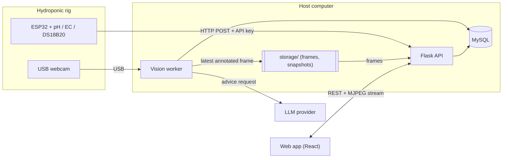
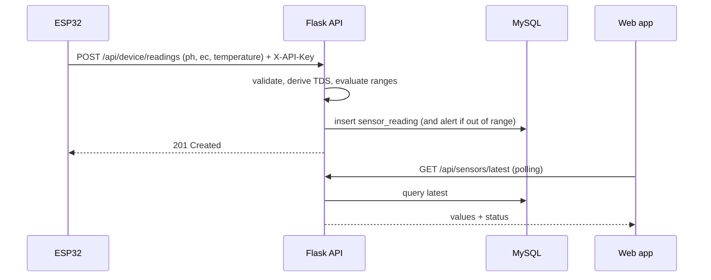
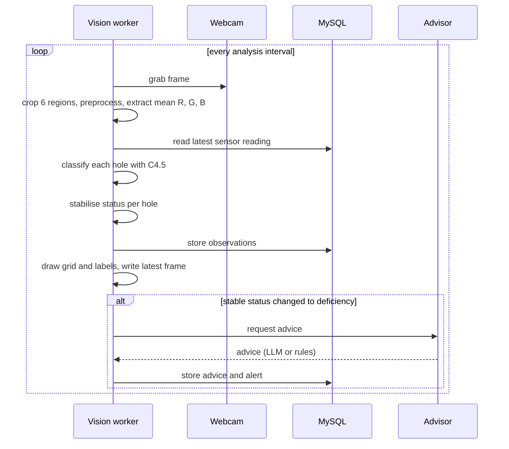

# Architecture

| Field        | Value                                                                             |
| ------------ | --------------------------------------------------------------------------------- |
| Product      | Nutrify                                                                           |
| Version      | 0.1 (draft)                                                                       |
| Last updated | 2026-11-05                                                                        |
| Related      | [PRD](PRD.md), [Schema](Schema.md), [API](API.md), [ML](ML.md), [Rules](Rules.md) |

## 1. Goals of the architecture

- Keep the camera, sensors, ML, and web app independently developable and testable.
- Make the primary model (C4.5) easy to explain and easy to replace or extend.
- Stay simple enough to run on one Windows computer with no cloud dependency except the LLM.
- Degrade gracefully: a missing sensor, camera, or LLM must not take down the whole system.

## 2. System context

## 3. Runtime processes

| Process        | Entry point               | Port | Responsibility                                                                                   |
| -------------- | ------------------------- | ---- | ------------------------------------------------------------------------------------------------ |
| Flask API      | `backend/run_api.py`      | 5000 | REST API, authentication, ingestion, queries, MJPEG stream                                       |
| Vision worker  | `backend/run_worker.py`   | none | Owns the webcam; crops holes, extracts features, classifies, stabilises, stores, requests advice |
| Web app (dev)  | `pnpm dev` in `frontend/` | 5173 | React single-page app                                                                            |
| MySQL          | Laragon                   | 3306 | Persistent storage                                                                               |
| ESP32 firmware | `firmware/sensor-node`    | none | Reads sensors and posts readings                                                                 |

**Why a separate vision worker.** A webcam can be opened by only one process. Flask's development
reloader starts the application twice, which would fight over the camera. The worker is a
separate process that shares the same code package (`backend/app`) but has its own entry point.
The API never opens the webcam; it only serves the frames the worker writes.

## 4. Components

### 4.1 Frontend (`frontend/`)

- Vite, React, TypeScript, Tailwind CSS, shadcn/ui, TanStack Router, TanStack Query, TanStack
  Table, Recharts, Zustand (auth state), Axios (HTTP client).
- Feature-based folders under `src/features/` (auth, dashboard, live-camera, plants, sensors,
  history, dataset, models, advisor, devices, settings).
- All Bahasa Indonesia copy lives in `src/locales/id.ts`. Code, identifiers, and API values are English.
- Data refresh by polling (5 to 10 seconds) through TanStack Query; the live video is an
  `` pointing at the MJPEG endpoint.

### 4.2 Backend API (`backend/app/`)

| Layer            | Folder                                      | Responsibility                                                     |
| ---------------- | ------------------------------------------- | ------------------------------------------------------------------ |
| Entry and config | `__init__.py`, `config.py`, `extensions.py` | Application factory, environment settings, extension instances     |
| Routes           | `api/`                                      | Flask blueprints; thin, validate input, call services, return JSON |
| Schemas          | `schemas/`                                  | Pydantic request and response models                               |
| Models           | `models/`                                   | SQLAlchemy tables                                                  |
| Services         | `services/`                                 | Business logic (vision, classifier, advisor, alerting, ingestion)  |

Rule: routes contain no business logic; services never import Flask request objects.

### 4.3 Vision worker (`backend/app/services/vision/`)

| Module             | Responsibility                                                                          |
| ------------------ | --------------------------------------------------------------------------------------- |
| `webcam.py`        | Open the camera, fix exposure and white balance, grab frames                            |
| `roi.py`           | Load the 6 calibrated regions and crop them from a frame                                |
| `preprocessing.py` | Resize, blur, HSV conversion, colour threshold, morphology, contour selection, mean RGB |
| `stabilizer.py`    | Per-hole majority vote over recent results                                              |

The preprocessing code is shared with the ML workspace (`ml/src`) so training and runtime use
identical steps. Its parameters are stored in a versioned file next to the model artifacts.

### 4.4 Classifier (`backend/app/services/classifier/`)

- `c45.py` loads the C4.5 tree from JSON and walks it in pure Python (no scikit-learn needed at
  runtime). It returns the class, the rule path, and the leaf purity used as confidence.
- `registry.py` reads model artifacts and their metadata (version, metrics, feature order).
- SVM, Naive Bayes, and Random Forest are trained and evaluated offline in `ml/`. Their stored
  metrics feed the Models page. A runtime consensus check with the best comparator is optional
  and controlled by a setting (off by default).

### 4.5 Advisor (`backend/app/services/advisor/`)

| Module      | Responsibility                                   |
| ----------- | ------------------------------------------------ |
| `base.py`   | `Advisor` interface: `advise(context) -> Advice` |
| `gemini.py` | LLM provider implementation (replaceable)        |
| `rules.py`  | Deterministic fallback advice table              |
| `prompts/`  | Prompt templates                                 |

Contract:

- The LLM never decides the class. It receives facts only: class per hole, confidence, pH, EC,
  temperature, ideal ranges, and recent trend.
- It must return JSON with: `summary`, `likely_causes[]`, `suggested_actions[]`, `severity`.
  Output is validated; invalid or failed responses fall back to `rules.py`.
- Every advice record stores its source (`llm` or `rules`) and is shown as a suggestion only.
- Calls are made only when a stabilised status changes or a sensor stays out of range.
  Results are cached by (status, sensor band) to limit calls.

### 4.6 Machine learning workspace (`ml/`)

Notebooks for inventory, preprocessing, tuning, feature extraction, training, and comparison;
`ml/src` for shared code; `ml/models` for artifacts and `registry.json`; `ml/data` for datasets
(raw data is not committed). See [ML](ML.md).

### 4.7 Firmware (`firmware/sensor-node/`)

PlatformIO project for the ESP32. Reads pH, EC, and DS18B20 temperature, applies temperature
compensation to EC, and posts JSON to `/api/device/readings` with an `X-API-Key` header.

## 5. Key flows

### 5.1 Sensor ingestion

### 5.2 Analysis cycle

Details:

- Display frames are refreshed several times per second; analysis runs once per analysis
  interval (default 10 seconds, configurable).
- If the latest sensor reading is older than the freshness limit, classification is skipped and an
  alert is raised instead of using stale values.
- The latest frame is written to a temporary file and renamed, so the API never reads a partial image.
- Frames, snapshots, and logs live in `storage/` and are not committed.

### 5.3 Live view

The API exposes `GET /api/camera/stream` (MJPEG). It repeatedly reads the worker's latest
annotated frame, so annotations are always aligned with the image. The page also polls
`/api/plants/latest` for the side panel (rule path, advice, sensor context).

## 6. Data

- MySQL 8 (InnoDB, `utf8mb4`), migrations with Flask-Migrate (Alembic). Tables are defined in [Schema](Schema.md).
- All timestamps are stored in UTC; the web app displays Asia/Jakarta (WIB).
- Class and status codes are English (`normal`, `n_deficiency`, `fe_deficiency`); the UI maps them to Indonesian labels.
- Dataset column order: `Mean_R, Mean_G, Mean_B, pH, EC, Temperature, label`.

## 7. API conventions

| Topic       | Convention                                                                     |
| ----------- | ------------------------------------------------------------------------------ |
| Base path   | `/api`                                                                         |
| Format      | JSON; `snake_case` field names                                                 |
| User auth   | `Authorization: Bearer <JWT>`; tokens expire                                   |
| Device auth | `X-API-Key` header (keys stored hashed)                                        |
| Errors      | `{ "error": { "code": "...", "message": "..." } }` with the proper HTTP status |
| Pagination  | `page`, `page_size`; response includes totals                                  |
| Time        | ISO 8601 in UTC                                                                |

Endpoint list: [API](API.md).

## 8. Security

- Passwords hashed; JWT with expiry; role checks (admin, viewer) on write endpoints.
- Secrets only in environment files (`backend/.env`, `firmware/**/include/secrets.h`), never committed.
- CORS restricted to configured origins; request validation on every input.
- Device endpoints accept only a valid API key; the LLM key stays on the server.

## 9. Configuration

| Item                             | Location                                                                 |
| -------------------------------- | ------------------------------------------------------------------------ |
| Backend settings                 | `backend/.env` (template: `backend/.env.example`)                        |
| Frontend settings                | `frontend/.env` (template: `frontend/.env.example`)                      |
| Firmware secrets                 | `firmware/sensor-node/include/secrets.h` (template: `secrets.example.h`) |
| Runtime thresholds and intervals | `settings` table, editable in the web app                                |

## 10. Deployment

Target is a single Windows computer.

- Development: start MySQL (Laragon), then run API, worker, and frontend in separate terminals
  (a helper script in `scripts/` starts all three).
- Production-like: Flask served by Waitress, the frontend built with `pnpm build` and served as static files.
- No container or cloud setup is required for this project.

## 11. Observability

- Python `logging` with rotating files under `logs/` (not committed) for API and worker.
- `/api/health` reports API and database status; the Devices page reports last-seen times.
- Alerts are raised for offline devices, stale sensors, and out-of-range values.

## 12. Testing strategy

| Level      | Scope                                                                        | Tool                                      |
| ---------- | ---------------------------------------------------------------------------- | ----------------------------------------- |
| Unit       | Preprocessing (fixture images), stabiliser, C4.5 inference, advisor fallback | pytest                                    |
| API        | Routes, validation, auth, errors                                             | pytest + Flask test client, test database |
| Frontend   | Lint and type check; key components                                          | ESLint, TypeScript                        |
| End to end | Simulated device posting readings; sample frames                             | `scripts/simulate_device.py`              |
| Model      | Reproducible training and evaluation                                         | Notebooks with recorded parameters        |

## 13. Extensibility

| To add              | Do                                                                         |
| ------------------- | -------------------------------------------------------------------------- |
| A classifier        | Implement the classifier interface and register it in `registry.py`        |
| An advisor provider | Implement `Advisor` in `advisor/` and select it by configuration           |
| A sensor type       | Add a column and schema field, extend ingestion and the dashboard card set |
| A deficiency class  | Retrain with new labels; update class codes and the UI label map           |

## 14. Architecture decisions

| ID       | Decision                                                                   | Record                             |
| -------- | -------------------------------------------------------------------------- | ---------------------------------- |
| ADR-0001 | Flask and MySQL instead of FastAPI and PostgreSQL                          | `adr/0001-flask-and-mysql.md`      |
| ADR-0002 | C4.5 is the primary model; SVM, Naive Bayes, Random Forest are comparators | `adr/0002-c45-as-primary-model.md` |
| ADR-0003 | Webcam owned by a separate vision worker process                           | to be written                      |
| ADR-0004 | LLM is advice-only, with a rule-based fallback                             | to be written                      |
