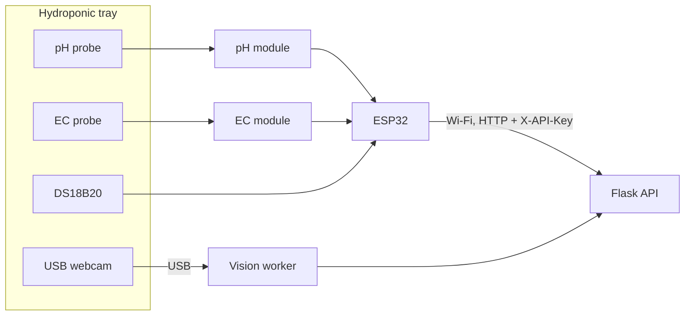
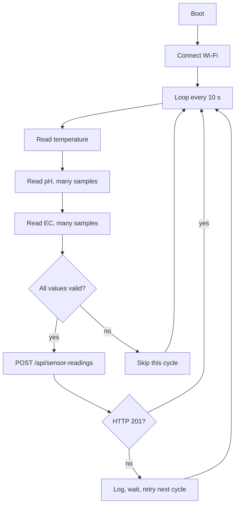

# Hardware

| Field        | Value                                                                                  |
| ------------ | -------------------------------------------------------------------------------------- |
| Product      | Nutrify                                                                                |
| Version      | 0.1 (draft)                                                                            |
| Status       | Design reference. Items marked **to confirm** depend on the exact parts used           |
| Firmware     | `firmware/sensor-node/` (PlatformIO, Arduino framework)                                |
| Last updated | 2026-11-05                                                                             |
| Related      | [Architecture](Architecture.md), [API](API.md), [Domain](Domain.md), [Setup](Setup.md) |

## 1. Overview

The hardware has two independent parts.

| Part                | Job                                                                    | Talks to                         |
| ------------------- | ---------------------------------------------------------------------- | -------------------------------- |
| Sensor node (ESP32) | Measures pH, EC, and water temperature and posts them every 10 seconds | Backend API over Wi-Fi           |
| Webcam on a PC      | Provides the image of the six plant holes                              | The vision worker on the same PC |



There is no ESP32-CAM and no actuator. The system only observes and advises.

## 2. Bill of materials

| Item                                   | Quantity | Notes                                        | Status            |
| -------------------------------------- | -------- | -------------------------------------------- | ----------------- |
| ESP32 development board (30 or 38 pin) | 1        | Any board exposing GPIO 34, 35, and 4        | To confirm        |
| Analog pH probe with interface module  | 1        | BNC probe plus signal board                  | To confirm model  |
| Analog EC probe with interface module  | 1        | Must output EC or conductivity, not only TDS | To confirm model  |
| DS18B20 waterproof probe               | 1        | Stainless sleeve, 1-Wire                     | Standard          |
| Resistor 4.7 kOhm                      | 1        | 1-Wire pull-up                               | Standard          |
| Voltage divider resistors              | 2        | Only if a module outputs above 3.3 V         | Depends on module |
| USB webcam                             | 1        | Fixed focus preferred; 720p or better        | To confirm model  |
| 5 V USB power supply for the ESP32     | 1        | 1 A or more                                  | Standard          |
| Waterproof enclosure with cable glands | 1        | Protects the ESP32 and modules from splashes | Standard          |
| pH buffer solutions                    | 2 sets   | For example pH 4.01 and pH 6.86 or 7.00      | Standard          |
| EC calibration solution                | 1        | For example 1.413 mS/cm                      | Standard          |
| Webcam mount (arm or fixed bracket)    | 1        | Rigid, does not drift                        | To design         |
| Constant light source                  | 1        | See section 6                                | To confirm        |

## 3. Sensor node

### 3.1 Signals and pins

The ESP32 inputs are 3.3 V only. Never feed 5 V into an ADC pin.

| Signal                | ESP32 pin | Type             | Notes                                          |
| --------------------- | --------- | ---------------- | ---------------------------------------------- |
| pH analog output      | GPIO 34   | ADC1, input only | Use ADC1; ADC2 does not work while Wi-Fi is on |
| EC analog output      | GPIO 35   | ADC1, input only | Same reason                                    |
| DS18B20 data          | GPIO 4    | Digital, 1-Wire  | 4.7 kOhm pull-up to 3.3 V                      |
| Status LED (optional) | GPIO 2    | Digital out      | Onboard LED on many boards                     |

Pin numbers are the proposal and can change with the board; they live in `include/config.h`.

### 3.2 DS18B20 wiring

| Probe wire    | Connect to                                            |
| ------------- | ----------------------------------------------------- |
| Red (VCC)     | 3.3 V                                                 |
| Black (GND)   | GND                                                   |
| Yellow (DATA) | GPIO 4, plus 4.7 kOhm resistor between DATA and 3.3 V |

- Resolution is set to 12 bits (about 0.06 Celsius). A conversion takes up to 750 ms.
- A reading of `-127` means the sensor is disconnected or failed. The firmware does not send
  it, and the API rejects it.

### 3.3 pH and EC modules (to confirm)

Typical analog interface boards run from 5 V and output 0 to 5 V, which can exceed the
ESP32 limit. For each module:

1. Read the datasheet and find the output voltage range.
2. If the output can exceed 3.3 V, scale it with a voltage divider (for example 10 kOhm and
   20 kOhm gives 2/3 of the input) or choose a module that outputs 3.3 V logic levels.
3. Record the divider ratio in `config.h` so the firmware reconstructs the module voltage.

EC requirement: the project needs EC in mS/cm. Many cheap modules report TDS only. A TDS
reading converts back with `ec = tds_ppm / 500`, but only when the module uses the same factor
as the project (see [Domain](Domain.md) section 2.3). Confirm the module's factor.

### 3.4 Probe interference

An EC probe passes a small current through the solution, and an analog pH probe measures a
tiny voltage in the same solution. Used together in one tank, they can disturb each other and
cause drifting or noisy readings.

Options, from simplest to most robust:

| Option         | Description                                                                                              |
| -------------- | -------------------------------------------------------------------------------------------------------- |
| Time-multiplex | Power the EC module from a GPIO or through a switch only while measuring EC, and read pH while it is off |
| Spacing        | Place the probes far apart, on opposite ends of the tank                                                 |
| Isolation      | Use a galvanic isolator on the pH or EC signal                                                           |

Pick one after a bench test (section 8). Time-multiplexing is the default plan because it costs
almost nothing.

### 3.5 Power and layout

- Power the ESP32 from a stable 5 V USB supply. Avoid sharing a supply with pumps, which add
  noise to ADC readings.
- Keep analog wires short and away from the pump and power wiring.
- Add a 100 nF capacitor across each analog output near the ESP32 if readings are noisy.
- Mount the ESP32 and modules in the enclosure above the water line. Probe cables pass through
  cable glands.

## 4. Firmware

### 4.1 Layout

```
firmware/sensor-node/
├── platformio.ini
├── include/
│   ├── config.h              # pins, intervals, calibration constants
│   ├── secrets.example.h     # template, committed
│   └── secrets.h             # real values, git-ignored
└── src/
    └── main.cpp
```

PlatformIO settings: `platform = espressif32`, `framework = arduino`, `board = esp32dev`
(adjust to the board). Libraries: OneWire, DallasTemperature, ArduinoJson.

### 4.2 Behaviour



Rules:

- Each analog value is the **median of about 30 samples** taken a few milliseconds apart, to
  suppress noise. Convert ADC counts to millivolts with `analogReadMilliVolts()` because the
  raw ESP32 ADC is non-linear.
- Reconnect to Wi-Fi automatically when the link drops.
- Failed posts are not buffered in version 1; the next cycle sends fresh data. A gap is
  visible in the app as a stale reading.
- The firmware sends `firmware_version` with each reading. It omits `recorded_at` because the
  ESP32 has no real-time clock; the server stamps the reading on arrival.
- The watchdog restarts the board if the loop hangs.

### 4.3 Request

```
POST http://<server-ip>:5000/api/sensor-readings
Content-Type: application/json
X-API-Key: <device key>

{ "ph": 6.12, "ec": 1.84, "temperature": 24.6, "firmware_version": "0.1.0" }
```

The key comes from `POST /api/devices` (shown once) and is stored in `secrets.h`.

### 4.4 Secrets

`secrets.h` holds the Wi-Fi name, Wi-Fi password, server address, and device API key. It is
git-ignored. `secrets.example.h` is committed with placeholders.

### 4.5 Reaching the backend from the ESP32

During development the API runs on a PC. Two things must be true:

- The API listens on the network, not only on localhost. `run_api.py` currently binds to
  `127.0.0.1`; for ESP32 tests it must bind to `0.0.0.0`. Treat this as a development setting
  and keep it configurable through the environment.
- The PC firewall allows inbound connections on port 5000 from the local network, and the ESP32
  and PC are on the same network.

The firmware uses the PC's local IP address, so give the PC a fixed address or a DHCP
reservation.

The connection is plain HTTP inside a local network. The device key is sent unencrypted on that
network, which is acceptable for a closed lab network but not for the internet. A public
deployment needs HTTPS (see [Architecture](Architecture.md)).

## 5. Calibration

Uncalibrated sensors make all thresholds meaningless. Calibrate at setup and repeat on a
schedule, and record the date and values.

### 5.1 pH (two points)

1. Rinse the probe with clean water, place it in buffer pH 6.86 (or 7.00), wait until stable,
   and record the module voltage `V7`.
2. Rinse, place it in buffer pH 4.01, wait, and record `V4`.
3. Compute the line `pH = slope x V + offset` with
   `slope = (7.00 - 4.01) / (V7 - V4)` and `offset = 7.00 - slope x V7`
   (use 6.86 instead of 7.00 if that buffer was used).
4. Store `slope` and `offset` in `config.h`.

Recalibrate about every one to two weeks at first; probes drift.

### 5.2 EC (one point, optionally two)

1. Place the probe in a 1.413 mS/cm standard solution at a known temperature.
2. Adjust the cell constant `K` in `config.h` so the computed EC matches the standard.
3. Verify at a second point if a second standard is available.

### 5.3 Temperature compensation

EC rises with temperature, about 2 percent per degree Celsius. Unless the module compensates
internally (to confirm), the firmware corrects to a 25 Celsius reference:

```
ec_25 = ec_raw / (1 + 0.02 x (T - 25))
```

The DS18B20 temperature is used for this. The value sent to the API is the compensated one, so
thresholds mean the same thing day and night.

### 5.4 Records

Keep a calibration log (date, buffers used, constants) in the project notes. Include the
constants in the firmware version history so old readings can be interpreted.

## 6. Webcam and lighting

### 6.1 Placement

- Fix the webcam so all six holes (3 x 2) are fully visible in one frame, with each plant
  inside its own region of interest and a margin around it.
- Mount it rigidly. A bump that shifts the view invalidates the ROIs and the model; if the
  camera moves, re-run ROI calibration.
- Aim to view the leaves from above or at a steady angle, avoiding direct reflection from the
  water or channel surface.
- Keep a fixed distance and angle across the whole data collection.

### 6.2 Lighting

- Use constant, diffuse lighting. Avoid direct sunlight that changes during the day, hard
  shadows, and colour-changing lights.
- Colour is the main feature, so lighting changes look like plant changes to the model. If the
  location uses natural light, collect data across morning, noon, and afternoon, or add a
  shaded enclosure with a fixed light.
- Optional: place a neutral grey or white reference card in the frame to monitor light
  changes.

### 6.3 Camera settings

- Resolution: 1280 x 720 is the working assumption (to confirm against the model).
- Disable auto exposure, auto white balance, and auto focus where the camera and driver allow
  it, and lock fixed values. On Windows, behaviour depends on the driver, so test that the
  settings actually hold (capture a few frames over several minutes and check the mean colour
  of a fixed grey patch).
- Warm up the camera for a few seconds after opening, then discard the first frames.
- The same settings are used for training images and runtime ([ML](ML.md) section 3.1).

### 6.4 PC

- The webcam is attached by USB to the PC that runs the vision worker. Use a short, good USB
  cable and avoid unpowered hubs.
- Only the worker opens the camera. Opening it from another program at the same time fails on
  most systems.
- Disable sleep for the PC and for USB power saving while the system runs.

## 7. Physical safety

- Keep mains electricity away from water. Power the node from a low-voltage USB supply.
- Put any mains socket or power strip out of reach of splashes, with a residual-current device
  (RCD or GFCI) on the circuit.
- Route cables so water cannot travel along them into the enclosure (drip loops).
- Handle pH and EC calibration solutions according to their labels.

## 8. Bench tests before installation

| Test                                          | Pass condition                                                           |
| --------------------------------------------- | ------------------------------------------------------------------------ |
| DS18B20 in water of known temperature         | Within about 0.5 Celsius of a reference thermometer                      |
| DS18B20 unplugged                             | Firmware skips the cycle and does not send `-127`                        |
| pH in buffer 4.01 and 6.86                    | Within 0.1 pH after calibration                                          |
| EC in 1.413 mS/cm standard                    | Within about 5 percent after calibration                                 |
| pH and EC probes in one container together    | Readings stay within tolerance (decide the interference option)          |
| Noise: 100 consecutive readings in one buffer | Spread within about 0.05 pH                                              |
| Wi-Fi drop and recovery                       | Node reconnects and resumes without a reset                              |
| Post to API                                   | `201` response and a new row in the dashboard                            |
| Webcam lock                                   | Mean colour of a fixed patch varies by only a few levels over 10 minutes |
| Run for 24 hours                              | No unexpected restarts, no stale periods                                 |

## 9. Troubleshooting

| Symptom                             | Likely cause                                       | Check                                                           |
| ----------------------------------- | -------------------------------------------------- | --------------------------------------------------------------- |
| pH or EC always at the maximum      | Module output above 3.3 V clipping, or a wrong pin | Measure the module output with a multimeter; check the divider  |
| Readings jump around                | Noise or probe interference                        | Add capacitors, increase samples, apply the interference option |
| Readings drift slowly               | Uncalibrated or ageing probe                       | Recalibrate; replace the probe                                  |
| Temperature `-127`                  | DS18B20 wiring or missing pull-up                  | Check the 4.7 kOhm resistor and the three wires                 |
| `401 unauthorized` from API         | Wrong or rotated device key                        | Update `secrets.h`, or rotate the key and reflash               |
| Node cannot reach the API           | Server bound to localhost, firewall, or wrong IP   | See section 4.5                                                 |
| Dashboard shows stale sensors       | Node offline or posting failing                    | Check power, Wi-Fi, and the serial log                          |
| Camera frames dark or colour shifts | Auto exposure or white balance active              | Re-lock settings; check lighting                                |
| Camera busy or fails to open        | Another program holds the webcam                   | Close other apps; run only the worker                           |

## 10. Open items

| Item                                              | Needed to decide                             |
| ------------------------------------------------- | -------------------------------------------- |
| Exact pH and EC module models                     | Wiring, voltage level, calibration constants |
| Whether the EC module compensates for temperature | Section 5.3                                  |
| Webcam model and its lockable settings            | Section 6.3                                  |
| Probe interference option                         | Bench test result                            |
| Final enclosure and mounting design               | Physical setup at the grow site              |
