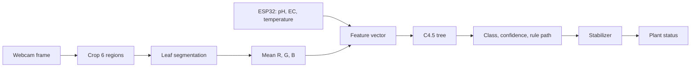

# Machine Learning

| Field         | Value                                                                                        |
| ------------- | -------------------------------------------------------------------------------------------- |
| Product       | Nutrify                                                                                      |
| Version       | 0.1 (draft)                                                                                  |
| Workspace     | `ml/`                                                                                        |
| Primary model | C4.5 decision tree (runs in production)                                                      |
| Comparators   | SVM, Naive Bayes, Random Forest (offline evaluation only)                                    |
| Last updated  | 2026-11-05                                                                                   |
| Related       | [Architecture](Architecture.md), [Schema](Schema.md), [Domain](Domain.md), [Rules](Rules.md) |

## 1. Purpose

Classify each of the six plant holes into one of three classes from one webcam frame and the
current water measurements.

| Class code      | Meaning               |
| --------------- | --------------------- |
| `normal`        | No visible deficiency |
| `n_deficiency`  | Nitrogen deficiency   |
| `fe_deficiency` | Iron deficiency       |

The system is decision support. It does not control pumps or dosing.

## 2. Overview



The same preprocessing code produces features for training and for runtime. This is the most
important rule in this document: if the two paths differ, reported accuracy is meaningless.

## 3. Image pipeline

Each plant hole is a fixed region of interest (ROI) in the frame. The pipeline runs per ROI.

| Step | Operation                                      | Purpose                               |
| ---- | ---------------------------------------------- | ------------------------------------- |
| 1    | Crop the ROI from the frame                    | Isolate one plant                     |
| 2    | Resize to a fixed size                         | Make area and speed comparable        |
| 3    | Gaussian blur                                  | Suppress sensor noise                 |
| 4    | Convert BGR to HSV                             | Separate colour from brightness       |
| 5    | Threshold in HSV                               | Binary mask of leaf pixels (leaf = 1) |
| 6    | Morphology (opening, then closing)             | Remove specks, fill small holes       |
| 7    | Find contours, keep the largest leaf region(s) | Segmentation and bounding box         |
| 8    | Compute features on the masked pixels          | Mean R, G, B and leaf area ratio      |

Segmentation produces a **binary mask**. Colour features are computed only on pixels where the
mask is 1, so soil, tray, and background do not distort the colour.

Parameters (resize size, blur kernel, HSV thresholds, morphology kernel, minimum contour area)
are stored in the model registry entry (section 9) so that runtime uses exactly the values used
for training. Starting values are placeholders and are calibrated on webcam images.

### 3.1 Capture conditions

- Use the runtime webcam, with exposure and white balance locked, for every training image.
- Keep lighting, camera angle, and distance fixed. Re-calibrate the ROIs if the camera moves.
- Phone photos or assignment images must not be mixed into the final dataset, because colour
  response differs between cameras.

### 3.2 Known limitations

- Very pale leaf edges can fall outside the HSV threshold and be missed.
- Close-up photos can leak background into the mask; the leaf area ratio check (section 5)
  flags these.
- Colour depends on lighting. Locked camera settings reduce this but do not remove it; a new
  grow-light or a new location needs new calibration and likely new data.

## 4. Features

| Order | Feature     | Source             | Dataset column | Unit     |
| ----- | ----------- | ------------------ | -------------- | -------- |
| 1     | Mean R      | Masked leaf pixels | `Mean_R`       | 0 to 255 |
| 2     | Mean G      | Masked leaf pixels | `Mean_G`       | 0 to 255 |
| 3     | Mean B      | Masked leaf pixels | `Mean_B`       | 0 to 255 |
| 4     | pH          | Sensor node        | `pH`           | unitless |
| 5     | EC          | Sensor node        | `EC`           | mS/cm    |
| 6     | Temperature | DS18B20            | `Temperature`  | Celsius  |

Label column: `label` with the class codes from section 1.

The feature order is part of the model. The runtime classifier reads the order from the registry
and refuses to run on a mismatch.

`leaf_area_ratio` and the stabiliser are **not** model features. The ratio is stored on each
observation and used for quality control only.

### 4.1 Risk: sensor values as a shortcut

pH and EC describe the whole tray, so every plant in a frame shares them. If the training labels
correlate with the water values (for example all deficient samples were taken at low EC), the
model can learn the water values and ignore the leaf. Mitigation, required before reporting
results:

- Train and report three variants: image features only, sensor features only, and combined.
- Describe how deficiency samples were obtained and under which water conditions.
- If the combined model is not clearly better than the best single group, say so.

## 5. Quality control

A frame result is stored with a `qc_status` and excluded from datasets unless it is `ok`.

| `qc_status`    | Condition                                                                                 | Effect                           |
| -------------- | ----------------------------------------------------------------------------------------- | -------------------------------- |
| `ok`           | All checks pass                                                                           | Used normally                    |
| `invalid_leaf` | Leaf area ratio below a minimum (no leaf visible) or above a maximum (background leakage) | Not classified; status unchanged |
| `stale_sensor` | Latest sensor reading older than `sensor_stale_seconds`                                   | Not classified                   |
| `needs_check`  | Classified, but confidence below the review threshold                                     | Kept, shown for review           |

Thresholds are placeholders to calibrate on webcam data and are stored in settings or the
registry, not hard-coded.

## 6. Models

| Model                                   | Role       | Where it runs                         |
| --------------------------------------- | ---------- | ------------------------------------- |
| C4.5 decision tree                      | Primary    | Backend worker, pure Python from JSON |
| SVM (RBF kernel, standardised features) | Comparator | Offline notebooks and reports         |
| Gaussian Naive Bayes                    | Comparator | Offline                               |
| Random Forest                           | Comparator | Offline                               |

Why C4.5 is primary: it gives an explicit rule path for every prediction, which the dashboard
shows and the advisor uses as evidence. It needs no feature scaling, handles continuous
features through threshold splits, and the project title names it. The comparators exist to
show how it performs against other methods, not to replace it.

### 6.1 C4.5 implementation

- Implemented in `ml/src/c45.py` (information gain ratio, binary threshold splits on
  continuous features, pruning to limit over-fitting).
- Hyper-parameters (maximum depth, minimum samples per leaf, pruning strength) are chosen by
  grouped cross-validation on the training set only.
- A scikit-learn tree with `criterion="entropy"` may be used as a sanity cross-check, never as
  the shipped model.

### 6.2 Exported tree

The trained tree is exported to a JSON file and loaded at runtime without scikit-learn. Each
internal node stores a feature and a threshold. Each leaf stores the class, the number of
training samples, and the class distribution.

Runtime output per frame:

| Output            | Definition                                                                                     |
| ----------------- | ---------------------------------------------------------------------------------------------- |
| `predicted_class` | Class of the leaf reached                                                                      |
| `confidence`      | Purity of that leaf (share of training samples in the leaf that belong to the predicted class) |
| `rule_path`       | Ordered list of conditions from the root to the leaf                                           |

Confidence is a measure of how pure the leaf was in training. It is not a calibrated
probability and must not be presented as one.

### 6.3 Stabiliser

Single-frame predictions flicker. A plant's status changes only when a new class has at least
`stabilizer_min_votes` of the last `stabilizer_window` results (defaults 3 of 5). Frames with
`invalid_leaf` or `stale_sensor` do not vote.

### 6.4 Optional consensus check

When `consensus_enabled` is true, the worker also runs a comparator model and flags
disagreements as `needs_check`. It is off by default and does not change the displayed class.

## 7. Dataset

### 7.1 Collection

1. Capture frames with the runtime webcam at the normal analysis cadence, with the sensor node
   running, so each observation stores the matching pH, EC, and temperature.
2. Review and label observations in the web app (`PATCH /observations/{id}/label`). The label
   is a human judgement, ideally confirmed by a plant expert.
3. Export with `GET /dataset/export` (labeled and `qc_status = 'ok'` rows only).

### 7.2 Raw images

Raw captures are stored under `storage/snapshots/` at runtime, and any images collected for
training sit in `ml/data/raw/` (git-ignored). Processed CSV files live in `ml/data/processed/`.

### 7.3 Splitting

- Never split by random row. Frames of one plant minutes apart are nearly identical, so a
  random split leaks the answer from train to test.
- Split by **plant and time block**: whole plants or whole time blocks go to either train or
  test. Use grouped cross-validation (group = plant and time block) for tuning.
- Keep a final test set untouched until the last evaluation.
- Fit any scaler on the training set only, then apply it to the test set.

### 7.4 Class imbalance

Nitrogen deficiency has very few real samples so far (2 of 106 early photos). Consequences and
rules:

- Report per-class metrics, not accuracy alone.
- Use macro F1 as the headline metric, because accuracy hides a missed minority class.
- Use class weights or resampling **inside training folds only**. Never resample before the
  split.
- Collect more real deficiency data. Augmented copies of the same photo count as one source
  and must stay on the same side of the split.
- Synthetic data from the earlier assignment is not evidence of real performance and is never
  reported as such.

## 8. Evaluation

All models use the same features, the same split, and the same metrics.

| Metric                                                          | Why                                             |
| --------------------------------------------------------------- | ----------------------------------------------- |
| Accuracy                                                        | Easy to read, but misleading under imbalance    |
| Macro F1                                                        | Headline metric, treats every class equally     |
| Per-class precision and recall                                  | Shows which deficiency is missed or over-called |
| Confusion matrix                                                | Shows which classes are confused                |
| Mean and standard deviation over grouped cross-validation folds | Shows stability                                 |

Required comparisons:

1. Four models on the same split (C4.5, SVM, Naive Bayes, Random Forest).
2. Feature ablation for the primary model: image only, sensors only, combined (section 4.1).
3. Inference time per frame for the primary model, to confirm it fits the analysis interval.

Reports and figures are saved to `ml/reports/` (`tables/` and `figures/`).

### 8.1 Decision rule

C4.5 stays the shipped model. If a comparator is clearly better, the result is reported as a
finding with its numbers, and the choice to switch is made deliberately with the supervisor and
recorded in an ADR, because the project title names C4.5.

## 9. Model registry

`ml/models/registry.json` lists every trained model. The backend reads it for `GET /models` and
to find the active model.

```json
{
  "active_version": "c45-0.1.0",
  "models": [
    {
      "version": "c45-0.1.0",
      "algorithm": "c45",
      "role": "primary",
      "trained_at": "2026-11-20",
      "artifact": "c45-0.1.0.json",
      "features": ["Mean_R", "Mean_G", "Mean_B", "pH", "EC", "Temperature"],
      "classes": ["normal", "n_deficiency", "fe_deficiency"],
      "preprocessing": {
        "resize": [256, 256],
        "blur_kernel": 5,
        "hsv_lower": [25, 40, 40],
        "hsv_upper": [95, 255, 255],
        "morphology_kernel": 5,
        "min_leaf_area_ratio": 0.05,
        "max_leaf_area_ratio": 0.9
      },
      "dataset": {
        "rows": 0,
        "description": "to be filled after data collection",
        "seed": 42
      },
      "metrics": { "accuracy": 0.0, "macro_f1": 0.0, "per_class": {} }
    }
  ]
}
```

All numbers above are placeholders. Each version is immutable; retraining creates a new version.

## 10. Workspace layout

```
ml/
├── notebooks/        # exploration, numbered in order of use
├── src/              # reusable code imported by notebooks and by the backend worker
│   ├── preprocessing.py   # image pipeline (section 3)
│   ├── features.py        # feature vector and quality checks
│   ├── c45.py             # C4.5 implementation and JSON export
│   ├── evaluation.py      # splits, metrics, ablation
│   └── registry.py        # read and write registry.json
├── models/           # registry.json and model artifacts
├── data/
│   ├── raw/          # captured images (git-ignored)
│   ├── interim/      # intermediate masks and crops (git-ignored)
│   └── processed/    # exported CSV datasets
└── reports/
    ├── figures/
    └── tables/
```

The backend worker imports the pipeline from `ml/src/` through one thin adapter so the logic is
never duplicated. Rule: preprocessing is written once.

Notebooks from the assignment phase (image preprocessing experiments) move into
`ml/notebooks/` with English names, and their functions move into `ml/src/preprocessing.py`.

## 11. Workflow

| Step | Action                                                      | Output                      |
| ---- | ----------------------------------------------------------- | --------------------------- |
| 1    | Calibrate camera, lock exposure and white balance, set ROIs | `roi_config`                |
| 2    | Capture frames with sensors running                         | Observations and snapshots  |
| 3    | Label observations in the web app                           | Labeled rows                |
| 4    | Export dataset                                              | CSV in `ml/data/processed/` |
| 5    | Split by plant and time block                               | Train, validation, test     |
| 6    | Train and tune on grouped cross-validation                  | Candidate models            |
| 7    | Evaluate all models, run the ablation                       | Reports                     |
| 8    | Export the C4.5 tree and register a new version             | Registry entry and artifact |
| 9    | Set `active_version` and restart the worker                 | New model in production     |

Retrain when the camera, lighting, or grow location changes, or when enough new labeled data
has been collected.

## 12. Reproducibility

- Fixed random seeds, recorded in the registry.
- The registry stores the dataset description and the preprocessing parameters of each version.
- Environment pinned through the backend requirements and a recorded Python version.
- Every reported number can be regenerated from the exported CSV and the notebook or script
  that produced it.

## 13. Limitations to state in the report

- The first model is trained on a small, single-location dataset; results do not generalise to
  other cameras, lighting, or varieties without new data.
- Nitrogen deficiency samples are scarce, so its recall has wide uncertainty.
- Labels are human judgements and may contain errors.
- The system recognises only three classes. Other stresses (pests, disease, other nutrients)
  can be misclassified as one of the three.
- Confidence is leaf purity, not a probability.
