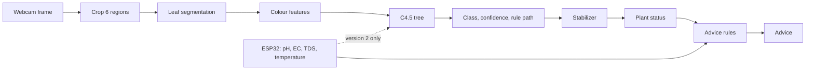

# Machine Learning

| Field          | Value                                                                                        |
| -------------- | -------------------------------------------------------------------------------------------- |
| Product        | Nutrify                                                                                      |
| Version        | 0.2 (draft)                                                                                  |
| Workspace      | `ml/`                                                                                        |
| Primary model  | C4.5 decision tree (runs in production)                                                      |
| Comparators    | SVM, Naive Bayes, Random Forest (offline evaluation only)                                    |
| Model versions | Version 1: colour features from the leaf image. Version 2: colour plus water measurements    |
| Last updated   | 2026-11-18                                                                                   |
| Related        | [Architecture](Architecture.md), [Schema](Schema.md), [Domain](Domain.md), [Rules](Rules.md) |

## 1. Purpose

Classify each of the six plant holes into one of three classes from one webcam frame. Version 2
adds the current water measurements as inputs.

| Class code      | Meaning               |
| --------------- | --------------------- |
| `normal`        | No visible deficiency |
| `n_deficiency`  | Nitrogen deficiency   |
| `fe_deficiency` | Iron deficiency       |

The system is decision support. It does not control pumps or dosing.

## 2. Overview

### 2.1 Model versions

The original plan was one model that reads leaf colour together with pH, EC, and water
temperature. A training row must then say "the leaf looked like this while the water measured
this". No public image dataset has water measurements, and joining sensor values from another
tank to someone else's photos would invent the relationship the model is supposed to learn. The
project therefore trains in two stages.

| Version | Model inputs                                    | Training data                                                   | Role of the sensors                                     |
| ------- | ----------------------------------------------- | --------------------------------------------------------------- | ------------------------------------------------------- |
| 1       | Leaf colour from the image                      | Secondary image dataset (section 7.1), real labelled photos     | Shown live; used by the advice rules next to the class  |
| 2       | Leaf colour, pH, EC, temperature (ppm optional) | Own recordings: frame and sensor reading taken at the same time | Part of the feature vector; the ablation in 4.1 applies |

Version 2 is a planned extension. It needs paired data (section 7.5) and is not claimed as a
result before that data exists. The application stores a sensor snapshot with every observation,
so paired data accumulates while the system runs.

Both versions use the same preprocessing, the same C4.5 implementation, and the same notebooks.
Only the feature list and the dataset change, and the registry records which list a model uses.

### 2.2 Data flow at runtime (version 1)



Example of how the two sources meet: the tree reports yellowing (`n_deficiency`) while the pH is
outside its range. The advice rules then tell the grower to check the pH first, because a
locked-out nutrient looks the same as a missing one. The rules are the `*_out_of_range` rules in
[API](API.md) section 11.

The same preprocessing code produces features for training and for runtime. This is the most
important rule in this document: if the two paths differ, reported accuracy is meaningless.

## 3. Image pipeline

Each plant hole is a fixed region of interest (ROI) in the frame. The pipeline runs per ROI. The
training images of version 1 already show one plant each, so step 0 is skipped for them.

| Step | Operation                                                                               | Purpose                                  |
| ---- | --------------------------------------------------------------------------------------- | ---------------------------------------- |
| 0    | Crop the ROI from the frame (runtime only)                                              | Isolate one plant                        |
| 1    | Resize to 256 x 256 (area interpolation)                                                | Make area and speed comparable           |
| 2    | Gaussian blur, 5 x 5 kernel, sigma computed from the kernel                             | Suppress noise before segmentation       |
| 3    | Convert to CIELAB                                                                       | Separate colour from lightness           |
| 4    | Threshold one colour channel with Otsu's method (a\*, b\*, or chroma)                   | Binary mask of leaf pixels (leaf = 1)    |
| 5    | Morphology: opening, then closing, 5 x 5 ellipse; keep leaf blobs by the component rule | Remove specks, fill holes, keep the leaf |
| 6    | Apply the mask to the resized, unblurred image                                          | Segmented leaf, background removed       |
| 7    | Find contours and the bounding box                                                      | Visual check and quality control only    |
| 8    | Compute colour features on the masked pixels                                            | `Mean_R`, `Mean_G`, `Mean_B`, Lab means  |

The blur is used only to obtain the mask. Colour features are measured on the unblurred image so
that blur does not average leaf colour with its surroundings. Step 7 does not change any feature.
The ROIs are fixed boxes from the camera calibration; no object detector is used.

Colour features are computed only on pixels where the mask is 1, so soil, tray, and background do
not distort the colour.

Parameters (resize size, blur kernel, threshold channel, morphology kernel, leaf area limits) are
stored in the model registry entry (section 9) so that runtime uses exactly the values used for
training.

### 3.1 Capture conditions

- Use the runtime webcam, with exposure and white balance locked, for every training image of
  version 2.
- Keep lighting, camera angle, and distance fixed. Re-calibrate the ROIs if the camera moves.
- Version 1 is trained on images from another camera and setting. That is a known domain gap
  (section 13). The project's own webcam photo is used as a separate check (section 7.1), not as
  training or test data.

### 3.2 Known limitations

- Yellowing leaves have a\* closer to zero than green leaves, so Otsu on a\* can cut off leaf area.
  On the project's dataset the opposite also happened: with a\*, background (board, soil) leaked
  into the masks of `n_deficiency` photos. Section 3.4 describes how the channel is chosen.
- Close-up photos can leak background into the mask; the leaf area ratio check (section 5)
  flags these.
- Colour depends on lighting. Locked camera settings reduce this but do not remove it; a new
  grow-light or a new location needs new calibration and likely new data.

### 3.3 Colour space details

CIELAB describes colour with three channels.

| Channel | Meaning                              | Range in theory   |
| ------- | ------------------------------------ | ----------------- |
| L\*     | Lightness                            | 0 to 100          |
| a\*     | Green (negative) to red (positive)   | about -128 to 127 |
| b\*     | Blue (negative) to yellow (positive) | about -128 to 127 |

OpenCV converts 8-bit images with a different scale: L is stored as `L* x 255 / 100`, and a and
b are stored with an offset of 128. The code converts back before computing any Lab feature:

$$
L^{*} = \frac{L_{8}\cdot 100}{255}, \qquad a^{*} = a_{8} - 128, \qquad b^{*} = b_{8} - 128
$$

Otsu's method picks the threshold $t$ that maximises the between-class variance of the
histogram:

$$
\sigma_{B}^{2}(t) = \omega_{0}(t)\,\omega_{1}(t)\,\bigl[\mu_{0}(t) - \mu_{1}(t)\bigr]^{2}
$$

where $\omega_{0}, \omega_{1}$ are the shares of pixels below and above $t$, and
$\mu_{0}, \mu_{1}$ are their mean values. Green leaf pixels have a low a\*, so the leaf is the
class below the threshold; for the b\* and chroma channels the leaf is the class above it. Otsu is implemented in `ml/src/` and verified against the OpenCV and
scikit-image implementations on the dataset images.

### 3.4 Mask quality check

Before any model is trained, notebook 01 chooses the segmentation channel and the component rule
from mask quality only, never from model accuracy. Every Roboflow image is segmented with each
channel (a\*, b\*, and chroma $C^{*} = \sqrt{a^{*2} + b^{*2}}$).

- **Channel.** An image counts as a disagreement when the lowest pairwise Dice coefficient between
  the three masks is below 0.85. In that case the channel with the lowest mean Dice against the
  other two is the outlier. For each channel, the share of outlier images is computed per class,
  and the channel is scored by its worst class, so a failure concentrated in one class is not
  hidden by the others. Channels within 0.05 of the best score are tied, and the tie is broken in
  the order a\*, b\*, chroma.
- **Component rule.** `largest` keeps only the largest blob after morphology. `relative` keeps every
  blob whose area is at least 5 percent of the largest blob, so leaves that are separated in the
  image are not dropped. The notebook reports how much mask area each rule gives and shows the
  affected images; the rule is then fixed by the project owner.
- The chosen channel and component rule are frozen for training and runtime and stored in the
  registry.
- Images whose mask area ratio is outside the limits (section 5) become `invalid_leaf`.

Decisions from the full run on the project's data (380 Roboflow images):

- **Channel b\*.** Worst-class share of outlier images: a\* 0.120 (`n_deficiency`, where the board
  and soil leaked into 11 masks), chroma 0.071 (`normal`), b\* 0.
- **Component rule `relative`** (5 percent of the largest blob). The mask area grows by more than
  10 percent in 3 to 9 percent of the images, and the added blobs are real leaves.
- **Area limits with k = 3:** 0.02 to 0.825, no image removed. With k = 1.5 the limits 0.174 to
  0.648 would have removed 19 images, all of them valid framing variants (wide shots and
  close-ups). The limits come from close-up photos and are recalculated on webcam data before
  they are used at runtime.
- **Result:** 380 of 380 images pass quality control. Independent source photos: 72 (`normal`),
  20 (`n_deficiency`), 44 (`fe_deficiency`).

## 4. Features

| Feature set | Columns                                                                       | Used by   |
| ----------- | ----------------------------------------------------------------------------- | --------- |
| A1          | `Mean_R`, `Mean_G`, `Mean_B`                                                  | Version 1 |
| A2          | `Mean_R`, `Mean_G`, `Mean_B`, `Lab_L`, `Lab_a`, `Lab_b`                       | Version 1 |
| V2          | A1 or A2, plus `pH`, `EC`, `Temperature` (`TDS` instead of `EC` if preferred) | Version 2 |

A1 and A2 are both image-only. A2 adds the Lab means of the same leaf pixels, which separate
yellow from green more directly. Both sets are evaluated; section 8.1 says how one is chosen.

The column names avoid a clash between `Mean_B` (blue) and the Lab b\* channel, which is
`Lab_b`.

| Column        | Source             | Unit      |
| ------------- | ------------------ | --------- |
| `Mean_R`      | Masked leaf pixels | 0 to 255  |
| `Mean_G`      | Masked leaf pixels | 0 to 255  |
| `Mean_B`      | Masked leaf pixels | 0 to 255  |
| `Lab_L`       | Masked leaf pixels | 0 to 100  |
| `Lab_a`       | Masked leaf pixels | a\* units |
| `Lab_b`       | Masked leaf pixels | b\* units |
| `pH`          | Sensor node (V2)   | unitless  |
| `EC`          | Sensor node (V2)   | mS/cm     |
| `Temperature` | DS18B20 (V2)       | Celsius   |

TDS in ppm is computed from EC with a fixed conversion factor, so the two carry almost the same
information. Version 2 uses one of them, not both. The Sensors page shows both.

Label column: `label` with the class codes from section 1.

The feature order is part of the model. The runtime classifier reads the order from the registry
and refuses to run on a mismatch.

`leaf_area_ratio` and the stabiliser are **not** model features. The ratio is stored on each
observation and used for quality control only.

### 4.1 Risk: sensor values as a shortcut (version 2)

pH and EC describe the whole tray, so every plant in a frame shares them. If the training labels
correlate with the water values (for example all deficient samples were taken at low EC), the
model can learn the water values and ignore the leaf. Mitigation, required before reporting
version 2 results:

- Train and report three variants: image features only, sensor features only, and combined.
- Describe how deficiency samples were obtained and under which water conditions.
- If the combined model is not clearly better than the best single group, say so.

Version 1 has no sensor features, so this risk does not apply to it. The corresponding risk in
version 1 is a shortcut through the image background; the mask (section 3) and the per-class
mask comparison (section 3.4) address it.

### 4.2 Dataset tables

`ml/data/processed/features.csv`, written by notebook 01:

| Column                       | Meaning                                                        |
| ---------------------------- | -------------------------------------------------------------- |
| `image_id`                   | File name of the image                                         |
| `source_group`               | Class plus file name prefix (`n_deficiency:203`), or `primary` |
| `label`                      | Class code                                                     |
| `origin`                     | `roboflow` or `primary`                                        |
| `qc_status`                  | `ok` or `invalid_leaf`                                         |
| `mask_area_ratio`            | Leaf pixels divided by all pixels, for quality control only    |
| `Mean_R`, `Mean_G`, `Mean_B` | Colour features                                                |
| `Lab_L`, `Lab_a`, `Lab_b`    | Lab colour features                                            |

`ml/data/processed/splits.csv`, written by notebook 02:

| Column                          | Meaning                                                      |
| ------------------------------- | ------------------------------------------------------------ |
| `image_id`, `source_group`      | As above                                                     |
| `label`                         | Class code                                                   |
| `partition`                     | `train`, `test`, or `external` (the project's own photo)     |
| `fold_r1`, `fold_r2`, `fold_r3` | Fold number 0 to 4 in each of three repeats, train rows only |

## 5. Quality control

A frame result is stored with a `qc_status` and excluded from datasets unless it is `ok`.

| `qc_status`    | Condition                                                                                 | Effect                           |
| -------------- | ----------------------------------------------------------------------------------------- | -------------------------------- |
| `ok`           | All checks pass                                                                           | Used normally                    |
| `invalid_leaf` | Leaf area ratio above a maximum (background leakage)                                      | Not classified                   |
| `no_plant`     | Nothing green in the region: leaf area below the minimum or the colour too grey           | Not classified; hole shown empty |
| `stale_sensor` | Latest sensor reading older than `sensor_stale_seconds`                                   | Not classified                   |
| `needs_check`  | Classified, but confidence below the review threshold                                     | Kept, shown for review           |

The leaf area limits are derived from the mask area ratios of the training images in notebook 01
(Tukey fences, Q1 minus k IQR and Q3 plus k IQR with k = 3, bounded to 0.02 and 0.98) and stored in the
registry, not hard-coded. The confidence threshold is calibrated on the
validation folds.

Version 1 does not use sensor values for classification, so `stale_sensor` mainly protects the
paired dataset of version 2 and the advice rules. Whether to relax it for version 1 is an open
decision recorded in the [Roadmap](Roadmap.md).

## 6. Models

| Model                                            | Role       | Where it runs                         |
| ------------------------------------------------ | ---------- | ------------------------------------- |
| C4.5 decision tree                               | Primary    | Backend worker, pure Python from JSON |
| SVM (linear, RBF, or polynomial kernel, see 6.5) | Comparator | Offline notebooks and reports         |
| Gaussian Naive Bayes                             | Comparator | Offline                               |
| Random Forest                                    | Comparator | Offline                               |

Why C4.5 is primary: it gives an explicit rule path for every prediction, which the dashboard
shows and the advisor uses as evidence. It needs no feature scaling, handles continuous
features through threshold splits, and the project title names it. The comparators exist to
show how it performs against other methods, not to replace it. Section 8.1 states in advance
what happens if it performs clearly worse.

### 6.1 C4.5 implementation

- Implemented in `ml/src/c45.py`. The decision is final: the project uses its own
  implementation, not a library, so that gain ratio, pruning, and the per-leaf sample counts
  are under the project's control and can be explained.
- Entropy, information gain, split information, and gain ratio for a set $S$ and attribute $A$:

$$
H(S) = -\sum_{i=1}^{k} p_{i}\log_{2}p_{i}
$$

$$
\mathrm{Gain}(S,A) = H(S) - \sum_{v}\frac{|S_{v}|}{|S|}\,H(S_{v})
$$

$$
\mathrm{SplitInfo}(S,A) = -\sum_{v}\frac{|S_{v}|}{|S|}\log_{2}\frac{|S_{v}|}{|S|}, \qquad
\mathrm{GainRatio}(S,A) = \frac{\mathrm{Gain}(S,A)}{\mathrm{SplitInfo}(S,A)}
$$

- Continuous features use binary splits `value <= threshold`. Candidate thresholds are the
  midpoints between neighbouring distinct values whose classes differ. Among candidates whose
  gain is at least the average gain, the one with the highest gain ratio wins.
- Pruning has two parts, and both are evaluated:
  - **Pre-pruning** stops growth early: maximum depth and minimum samples per leaf.
  - **Post-pruning** grows the full tree, then replaces subtrees by leaves when the pessimistic
    error estimate does not get worse (error-based pruning with a confidence factor, Quinlan's
    default 0.25).
- Four variants are trained and reported: unpruned, pre-pruned, post-pruned, and both. The
  report shows leaves, depth, training score, and validation score for each, and a curve of
  confidence factor against tree size and validation F1.
- Hyper-parameters are chosen by grouped cross-validation on the training set only.

| Hyper-parameter      | Values                 |
| -------------------- | ---------------------- |
| Maximum depth        | 3, 4, 5, 6, unlimited  |
| Minimum samples/leaf | 2, 5, 10               |
| Confidence factor    | 0.05, 0.10, 0.25, 0.40 |

- A scikit-learn tree with `criterion="entropy"` may be used as a sanity cross-check, never as
  the shipped model. It is CART with an entropy criterion, not C4.5.

### 6.2 Exported tree

The trained tree is exported to a JSON file and loaded at runtime without scikit-learn. Each
internal node stores a feature and a threshold. Each leaf stores the class, the number of
training samples, and the class distribution.

Runtime output per frame:

| Output            | Definition                                                                                     |
| ----------------- | ---------------------------------------------------------------------------------------------- |
| `predicted_class` | Class of the leaf reached                                                                      |
| `confidence`      | Purity of that leaf (share of training samples in the leaf that belong to the predicted class) |
| `rule_path`       | Ordered list of conditions from the root to the leaf                                           |

Confidence is a measure of how pure the leaf was in training. It is not a calibrated
probability and must not be presented as one.

### 6.3 Stabiliser

Single-frame predictions flicker. A plant's status changes only when a new result has at least
`stabilizer_min_votes` of the last `stabilizer_window` results (defaults 2 of 3). With an
analysis every 2 seconds a plant that is swapped shows its new status after about 4 seconds.

Every analysis votes, with one of five results: the three classes, `no_plant` (nothing green in
the region, so a removed plant is noticed too) and `needs_check` (leaf area outside the limits of
the model, or the best comparator disagrees). `no_plant` is decided before the model runs: the
leaf area is under `min_leaf_area_ratio`, or the colourfulness of the masked pixels (distance
from grey in CIELAB, `MIN_LEAF_CHROMA`) is too low, as it is for the white pipe and the pot.

### 6.4 Optional consensus check

When `consensus_enabled` is true, the worker also runs every comparator model and flags
a plant as `needs_check` when the comparator with the highest macro F1 disagrees with the
primary model. It is off by default and does not change the displayed class.

### 6.5 Comparators

All comparators use scikit-learn. Scaling is part of a pipeline and is fitted inside each
training fold only.

**SVM.** The kernel is not fixed in advance. Three kernels are tuned and compared on the same
folds, and the winner is chosen by validation macro F1. The features are standardised.
Multi-class classification uses scikit-learn's one-versus-one scheme, and classes are weighted
by their frequency.

| Kernel     | $K(x, z)$                                       | Tuned parameters |
| ---------- | ----------------------------------------------- | ---------------- |
| Linear     | $x^{\top}z$                                     | C                |
| RBF        | $\exp\bigl(-\gamma\,\lVert x-z\rVert^{2}\bigr)$ | C, $\gamma$      |
| Polynomial | $(\gamma\,x^{\top}z + 1)^{3}$                   | C, $\gamma$      |

C takes the values 0.1, 1, 10, 100; $\gamma$ takes 0.001, 0.01, 0.1, 1.

**Gaussian Naive Bayes.** Assumes the features are independent given the class and normally
distributed within each class:

$$
\hat{y} = \arg\max_{c}\; P(c)\prod_{j} \mathcal{N}\bigl(x_{j}\mid\mu_{c,j},\sigma_{c,j}^{2}\bigr)
$$

The variance smoothing takes the values $10^{-9}$, $10^{-7}$, $10^{-5}$, $10^{-3}$.

**Random Forest.** Many trees, each grown on a bootstrap sample with a random subset of
features at every split (square root of the feature count), combined by majority vote. The
split criterion is Gini impurity:

$$
G(S) = 1 - \sum_{i=1}^{k} p_{i}^{2}
$$

| Hyper-parameter      | Values           |
| -------------------- | ---------------- |
| Number of trees      | 100, 300, 500    |
| Maximum depth        | 5, 10, unlimited |
| Minimum samples/leaf | 1, 2, 5          |

The out-of-bag error is reported against the number of trees.

## 7. Dataset

### 7.1 Version 1 data

| Item        | Value                                                                                       |
| ----------- | ------------------------------------------------------------------------------------------- |
| Source      | Secondary dataset exported from Roboflow, `train` split (about 950 images before selection) |
| Selection   | By hand: top view, one frame with one net pot (one plant), clear and low noise              |
| Labels      | Assigned by the project team and justified with a grower and an agro-informatics lecturer   |
| Kept images | 380 (`normal` 112, `n_deficiency` 92, `fe_deficiency` 176)                                  |
| Own photo   | 8 images from one photo of the project's miniature, all `normal`, kept in `primary/`        |

- Roboflow applies augmentation to the `train` split, so one source photo appears several times
  with flips, rotations, or brightness changes. The file name prefix before `_png` (for
  example `203`) identifies the source photo inside its class folder. The numbering can restart
  in each class, so a source group is the class plus the prefix (`n_deficiency:203`). Notebook 01
  counts the real number of independent source photos per class and checks for identical files
  across classes; that count, not the number of files, is the sample size.
- Neighbouring numbers (for example `243` and `244`) may show the same plant photographed in
  sequence. Notebook 02 checks this and, once the project team confirms it, groups neighbouring
  numbers into blocks, so that near-identical frames never fall on both sides of a split.
- The eight own images are one group. They are excluded from training and testing and serve only
  as a check that the pipeline gives plausible colour values on the project's webcam.
- The dataset is frozen before modelling. Notebook 01 writes a manifest (file names and counts
  per class). Images are not added or removed after seeing model results.
- Manual selection favours clean images, so test results may be better than live results. The
  report states this.
- The dataset page, version, licence, and augmentation settings are taken from the files
  `README.roboflow.txt` and `README.dataset.txt` inside the original export and cited in the
  report.

### 7.2 Raw images

Raw images sit under `ml/data/raw/` (git-ignored), one folder per class:

```
ml/data/raw/
├── normal/
├── n_deficiency/
├── fe_deficiency/
└── primary/
```

Original file names are kept, because they carry the source group. Live captures are stored
under `storage/snapshots/` at runtime. Processed CSV files live in `ml/data/processed/`.

### 7.3 Splitting

- Never split by random row. Several files come from the same source photo, and frames of one
  plant minutes apart are nearly identical, so a random split leaks the answer from train to
  test.
- Version 1: split by `source_group`, stratified by class, into 80 percent train and 20 percent
  test (one fold of a five-fold stratified grouped split). Tuning uses a five-fold stratified
  grouped cross-validation inside the train part, repeated three times with seeds 42, 43, and 44. There is no separate validation set; the cross-validation folds play that role and use
  the small dataset efficiently.
- Fallback: if any class has fewer than 15 source groups, a fixed 20 percent test set would hold
  fewer than three groups of that class. In that case notebook 02 switches to nested
  cross-validation (outer five folds grouped, inner five folds for tuning) and reports averages
  over the outer folds. The decision is made from the counts, before any model is trained.
- The test set is opened once, in notebook 07, after all parameters are locked.
- Fit any scaler, class weights, or resampling on the training folds only. Never augment or
  resample before the split.
- Version 2: split by plant and time block, with the same rules.

### 7.4 Class imbalance

The classes are moderately imbalanced (112, 92, 176 files, before counting groups). Rules:

- Report per-class metrics, not accuracy alone.
- Use macro F1 as the headline metric, because accuracy hides a missed minority class.
- Use class weights inside training folds only.
- Augmented copies of the same photo count as one source and stay on the same side of the
  split.
- Synthetic data from the earlier assignment is not evidence of real performance and is never
  reported as such. If synthetic rows are used to test the code, they carry `source = synthetic`
  and are removed from every reported number.

### 7.5 Version 2 collection

1. Run the miniature with the camera and sensor node, so each observation stores the matching
   pH, EC, and temperature.
2. Include conditions that really produce each class, and record how they were produced.
3. Label observations in the web app (`PATCH /observations/{id}/label`). The label is a human
   judgement, ideally confirmed by a plant expert.
4. Export with `GET /dataset/export` (labeled and `qc_status = 'ok'` rows only).
5. The minimum number of independent plants or time blocks per class is agreed with the
   supervisor before collection.

## 8. Evaluation

All models use the same features, the same split file, and the same metrics.

| Metric                                                  | Why                                             |
| ------------------------------------------------------- | ----------------------------------------------- |
| Accuracy                                                | Easy to read, but misleading under imbalance    |
| Macro F1                                                | Headline metric, treats every class equally     |
| Per-class precision and recall                          | Shows which deficiency is missed or over-called |
| Confusion matrix (counts and normalised)                | Shows which classes are confused                |
| Mean and standard deviation over cross-validation folds | Shows stability                                 |
| 95 percent bootstrap interval, resampling source groups | Shows the uncertainty of the test result        |

Every model notebook produces the same package, all computed from the same predictions:

- confusion matrix, per-class precision, recall, and F1, macro and weighted averages
- fold scores as a boxplot, with the hyper-parameter results as a table or heatmap
- one-versus-rest ROC and precision-recall curves
- learning curve (score against training size)
- permutation importance
- a gallery of misclassified images with the true and predicted label
- compute times (below)

Model-specific additions:

| Model         | Additions                                                                                      |
| ------------- | ---------------------------------------------------------------------------------------------- |
| C4.5          | Tree diagram, rule list, four pruning variants, pruning curve, per-leaf samples and confidence |
| SVM           | Kernel comparison, C and gamma heatmap, number of support vectors, 2D decision regions         |
| Naive Bayes   | Per-class distributions of each feature, class priors                                          |
| Random Forest | Out-of-bag error against number of trees, impurity importance, depth distribution              |

The ROC curve of C4.5 is a staircase with few steps because its score is the leaf purity; the
report says so.

Notebook 07 adds the combined table, side-by-side confusion matrices, shared ROC curves, a chart
of macro F1 with intervals, the comparison of feature sets A1 and A2, and the check on the
project's own photo.

Compute time is part of the evaluation. The notebooks record, with `time.perf_counter` and
several repeats (mean and standard deviation):

| Measurement                      | Unit         |
| -------------------------------- | ------------ |
| Preprocessing per image          | milliseconds |
| Training time of the final model | seconds      |
| Tuning time (all folds)          | seconds      |
| Prediction time per sample       | milliseconds |

Prediction time per sample is measured one sample at a time, because the live worker classifies
one hole at a time, six per frame. All training runs on the CPU; no GPU is used. The hardware is
listed in section 12.

### 8.1 Decision rule

These rules are written before any model is trained, and they are not changed after results
exist. Confirming the numbers with the supervisor before notebook 03 runs is a prerequisite.

**Choice of the feature set.** A2 replaces A1 only if the C4.5 cross-validation macro F1 of A2
exceeds that of A1 by more than the standard deviation of A1 over the folds. Otherwise A1 is
used, because it is simpler.

**Choice of the primary model.** C4.5 stays the shipped model when both conditions hold on the
final test set:

1. Its macro F1 is not more than 0.05 below the best model.
2. Its recall for `n_deficiency` and for `fe_deficiency` is at least 0.70, because a missed
   deficiency is worse than a false alarm.

If a condition fails, the result is reported with its numbers, and the choice to switch is made
deliberately with the supervisor and recorded in an ADR, because the project title names C4.5.
Parameters, data, and metrics are never changed to make C4.5 pass.

**Choice among C4.5 variants.** The variant with the highest cross-validation macro F1 is
shipped; on a tie the tree with fewer leaves is shipped.

**What is shipped.** The model that is evaluated on the test set (trained on the 80 percent
train part) is the model that is shipped, so the reported numbers describe it exactly.

## 9. Model registry

`ml/models/registry.json` lists every trained model. The backend reads it for `GET /models` and
to find the active model. The example below shows the format only; notebook 07 writes the real
values.

The `role` stored in an entry is the role at training time. The backend derives the current role
of every entry from `active_version`, so making another model primary (for example the SVM) means
changing only `active_version`, with no code change. The backend loads the model files with the
same library versions as `ml/requirements.txt`; a `.joblib` file saved with another scikit-learn
version may not load.

```json
{
  "active_version": "c45-0.1.0",
  "models": [
    {
      "version": "c45-0.1.0",
      "algorithm": "c45",
      "role": "primary",
      "trained_at": null,
      "artifact": "c45-0.1.0.json",
      "features": ["Mean_R", "Mean_G", "Mean_B"],
      "classes": ["normal", "n_deficiency", "fe_deficiency"],
      "preprocessing": {
        "resize": [256, 256],
        "blur_kernel": 5,
        "segmentation_channel": null,
        "threshold": "otsu",
        "component_rule": null,
        "min_component_ratio": 0.05,
        "morphology": {
          "kernel": "ellipse",
          "size": 5,
          "order": ["open", "close"]
        },
        "min_leaf_area_ratio": null,
        "max_leaf_area_ratio": null
      },
      "dataset": {
        "origin": "roboflow",
        "rows": 380,
        "source_groups": null,
        "seed": 42
      },
      "compute": {
        "cpu": null,
        "train_seconds": null,
        "predict_ms_per_sample": null
      },
      "metrics": { "accuracy": null, "macro_f1": null, "per_class": {} }
    }
  ]
}
```

`null` means "written by the notebook". The leaf area limits, the segmentation channel, and the
component rule are results of notebook 01. A version 2 entry lists the sensor columns in `features`. Each version is
immutable; retraining creates a new version.

## 10. Workspace layout

```
ml/
├── notebooks/        # numbered in order of use (section 10.1)
├── src/              # reusable code imported by notebooks and by the backend worker
│   ├── preprocessing.py   # image pipeline (section 3)
│   ├── features.py        # feature vector and quality checks
│   ├── c45.py             # C4.5 implementation and JSON export
│   ├── evaluation.py      # splits, metrics, plots, timing
│   └── registry.py        # read and write registry.json
├── models/           # registry.json and model artifacts
├── data/
│   ├── raw/          # images per class (git-ignored)
│   ├── interim/      # intermediate masks and crops (git-ignored)
│   └── processed/    # features.csv and splits.csv
├── reports/
│   ├── figures/
│   ├── results/      # per-model JSON: parameters, fold scores, predictions, timing
│   └── tables/
└── requirements.txt  # pinned versions, shared with the backend where they overlap
```

The backend worker imports the pipeline from `ml/src/` through one thin adapter so the logic is
never duplicated. Rule: preprocessing is written once.

Model artifacts: `c45-<version>.json` for the primary model, and `.joblib` files for the
comparators. A `.joblib` file can run code when loaded, so only files produced by this project
are loaded, and the scikit-learn version is pinned and recorded.

### 10.1 Notebooks

Preprocessing and modelling are separate. They meet only through `features.csv` and
`splits.csv`.

| Notebook           | Input                        | Output                                                              |
| ------------------ | ---------------------------- | ------------------------------------------------------------------- |
| `01_preprocessing` | Images in `ml/data/raw/`     | `features.csv`, `preprocessing_params.json`, manifest, mask figures |
| `02_dataset_split` | `features.csv`               | `splits.csv`, class and group audit                                 |
| `03_c45`           | `features.csv`, `splits.csv` | Results JSON, pruning comparison, tree JSON                         |
| `04_svm`           | `features.csv`, `splits.csv` | Results JSON, kernel comparison                                     |
| `05_naive_bayes`   | `features.csv`, `splits.csv` | Results JSON                                                        |
| `06_random_forest` | `features.csv`, `splits.csv` | Results JSON                                                        |
| `07_comparison`    | All results, test partition  | Final test evaluation, ablation, registry                           |

Notebooks 03 to 06 read only the train partition. Each runs both feature sets A1 and A2 and
saves the out-of-fold predictions. Notebook 07 refits each model with the locked parameters,
evaluates the test partition once with the same code for all models, applies section 8.1, and
writes the registry.

### 10.2 Notebook conventions

- Notebooks contain only headings, formulas, and code. Descriptions and interpretation of results
  are given in the discussion with the project owner and in the report, not inside the notebook.
- The headings and formula legends are Indonesian, like the web app. Code, file names, and
  column names are English.
- Headings: the notebook title uses `###`, its chapters `####`, subsections `#####`, and deeper
  levels `######`.
- Formulas are written in LaTeX, with the same symbols in every notebook.
- No placeholders: a notebook states only what it has computed.
- Functions live in `ml/src/`, so a notebook cell calls them instead of containing long code.
- Seed 42 everywhere; repeated cross-validation uses 42, 43, and 44.

## 11. Workflow

**Version 1**

| Step | Action                                                    | Output                              |
| ---- | --------------------------------------------------------- | ----------------------------------- |
| 1    | Place the images in `ml/data/raw/` and freeze the dataset | Manifest                            |
| 2    | Run notebook 01: pipeline, mask comparison, features      | `features.csv`                      |
| 3    | Run notebook 02: audit and split by source group          | `splits.csv`                        |
| 4    | Run notebooks 03 to 06: tune on cross-validation          | Per-model results                   |
| 5    | Run notebook 07: test evaluation, apply the decision rule | Reports, `registry.json`, tree JSON |
| 6    | Set `active_version` and restart the worker               | Model in production                 |

**Version 2** (after the miniature runs)

| Step | Action                                                      | Output                      |
| ---- | ----------------------------------------------------------- | --------------------------- |
| 1    | Calibrate camera, lock exposure and white balance, set ROIs | `roi_config`                |
| 2    | Capture frames with sensors running                         | Observations and snapshots  |
| 3    | Label observations in the web app                           | Labeled rows                |
| 4    | Export the dataset                                          | CSV in `ml/data/processed/` |
| 5    | Repeat notebooks 02 to 07 with the sensor columns           | New registry entry          |

Retrain when the camera, lighting, or grow location changes, or when enough new labeled data
has been collected.

## 12. Reproducibility

- Fixed random seeds, recorded in the registry.
- The registry stores the dataset description and the preprocessing parameters of each version.
- Python 3.10.6 and pinned library versions in `ml/requirements.txt`. The backend uses the same
  scikit-learn version, because the comparator artifacts must load there.
- Every reported number can be regenerated from the images, the notebooks, and the scripts that
  produced it.
- Timing runs use this machine, with the charger connected and other programs closed:

| Item   | Value                                            |
| ------ | ------------------------------------------------ |
| Laptop | Lenovo LOQ 15IAX9                                |
| CPU    | Intel Core i5-12450HX, 2.40 GHz                  |
| RAM    | 12 GB DDR5 (11.7 GB usable)                      |
| GPU    | Not used (RTX 3050 present, scikit-learn is CPU) |
| System | Windows 11 Home, 64-bit                          |
| Python | 3.10.6                                           |

## 13. Limitations to state in the report

- Version 1 is trained on a secondary dataset from another camera and setting, selected by hand.
  Results do not generalise to the project's webcam, lighting, or varieties without new data.
  The eight own images are only a plausibility check.
- The number of independent source photos is smaller than the number of files, because of
  Roboflow augmentation. Test results carry wide uncertainty, shown by the bootstrap interval.
- Labels are human judgements (team, grower, lecturer) and may contain errors.
- Version 1 does not use pH, EC, or temperature as model inputs. Their combined effect with leaf
  colour is untested until paired data exists (version 2).
- The system recognises only three classes. Other stresses (pests, disease, other nutrients)
  can be misclassified as one of the three.
- Confidence is leaf purity, not a probability.
