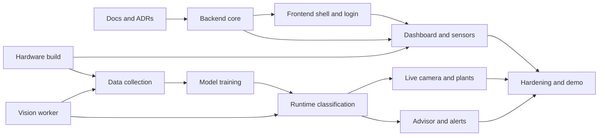

# Roadmap

| Field            | Value                                                                            |
| ---------------- | -------------------------------------------------------------------------------- |
| Product          | Nutrify                                                                          |
| Version          | 0.1 (draft)                                                                      |
| Planning horizon | 4 weeks of build after the documentation week                                    |
| Last updated     | 2026-11-05                                                                       |
| Related          | [PRD](PRD.md), [Architecture](Architecture.md), [Design](Design.md), [ML](ML.md) |

This document is the schedule and the status board. It orders the work, names what "done"
means for each milestone, and lists the risks that can move the dates. Week dates are targets
and must be checked against the academic calendar and agreed with the supervisor. If this
document and the milestone table in the PRD differ, this document is the current plan and the
PRD is updated to match.

## 1. Status

| Area                                                                           | Status                                        |
| ------------------------------------------------------------------------------ | --------------------------------------------- |
| Repository, tooling, MySQL, backend skeleton, frontend template running        | Done                                          |
| Documents: PRD, Architecture, Schema, Rules, API, ML, Domain, Hardware, Design | Done                                          |
| Documents: ADRs                                                                | Next                                          |
| Document: Setup                                                                | After the first full run (needs tested steps) |
| Backend features                                                               | Not started                                   |
| Frontend features                                                              | Not started                                   |
| Vision worker, model training                                                  | Not started                                   |
| Firmware                                                                       | Not started                                   |
| Real dataset collection                                                        | Not started (see risk R1)                     |

## 2. Strategy

- **Vertical slices.** Each milestone ends with something that runs end to end, so problems
  appear early instead of at integration.
- **Backend before frontend pages.** A small backend (schema, seed, login, ingestion) comes
  first so every screen connects to the real API from its first day. No throw-away mock data.
- **Parallel tracks.** Hardware and data collection start in week 1 and run beside the
  software, because they depend on time and plants, not on code.
- **Priority order (MoSCoW).** If time runs short, Could items are dropped first, then Should.
  Must items define the minimum acceptable system.

| Priority | Items                                                                                                                                                                                                |
| -------- | ---------------------------------------------------------------------------------------------------------------------------------------------------------------------------------------------------- |
| Must     | Login and roles, sensor ingestion, dashboard, live camera with six-region classification, plant status and rule path, history, model page with comparison results, advice with rule fallback, alerts |
| Should   | Dataset labelling and export, devices page, settings page including camera calibration, LLM advisor, stabiliser tuning                                                                               |
| Could    | Telegram notifications, comparator consensus check, editable fallback rules, tablet layout polish                                                                                                    |

## 3. Timeline

Dates are targets. Week 0 is the current week.

| Week | Dates (target) | Focus                                                                              |
| ---- | -------------- | ---------------------------------------------------------------------------------- |
| 0    | to 2026-11-08  | Documentation, ADRs, decisions                                                     |
| 1    | 2026-11-09     | Backend core; frontend cleanup and shell; start hardware and data collection       |
| 2    | 2026-11-16     | Dashboard and sensors end to end; vision worker and calibration                    |
| 3    | 2026-11-23     | Model training, runtime classification, plants and live camera; advisor and alerts |
| 4    | 2026-11-30     | Remaining pages, hardening, tests, demo, report                                    |

**Critical path:** hardware build, then data collection, then model training, then runtime
classification. Everything on the software side can finish earlier than this chain, so the chain
decides the end date.

## 4. Milestones

Each milestone is finished only when every "done when" line is true.

### M0. Foundations (done)

- [x] Monorepo, Git, conventions, `.gitignore`
- [x] MySQL database and application user
- [x] Backend skeleton with `GET /api/health`
- [x] Frontend template running locally
- [x] Core documents (see status)

### M1. Backend core (week 1)

Scope: SQLAlchemy models and migrations from [Schema](Schema.md); seed script; JWT login and
roles; settings, devices; sensor ingestion; request validation; error format.

Done when:

- [ ] `flask db upgrade` creates every table in [Schema](Schema.md) from an empty database.
- [ ] The seed script creates the admin user, 6 plants, 2 devices, and default settings.
- [ ] `POST /auth/login`, `GET /auth/me` work; viewer and admin permissions are enforced.
- [ ] `POST /sensor-readings` with a device key stores a reading and derives `tds_ppm`.
- [ ] `scripts/simulate_device.py` posts realistic readings.
- [x] pytest covers auth, validation errors, and ingestion.

### M2. Frontend shell and login (week 1)

Scope: remove unused template parts; apply tokens from [Design](Design.md); shell (sidebar,
header, theme, command palette); Indonesian strings in `locales/id.ts`; login connected to the
backend; route protection.

Done when:

- [ ] Only Nutrify routes remain; Clerk and unused pages are removed.
- [ ] Light and dark themes use the design tokens.
- [ ] Login works against the real API; wrong credentials show the error state.
- [ ] Viewer and admin see the correct navigation.
- [ ] Lint and type check pass.

### M3. Dashboard and sensors end to end (week 2)

Scope: `GET /dashboard/summary`, sensor history, latest reading with status; Dashboard and
Reservoir sensors pages; ESP32 firmware posting real readings.

Done when:

- [ ] The ESP32 posts readings and the four KPI cards update.
- [ ] Charts show history with the ideal band and range tabs.
- [ ] Stale data and offline device states appear when the node is unplugged.
- [ ] Sensor calibration done and recorded ([Hardware](Hardware.md) section 5).
- [ ] 24-hour run without a gap or restart.

### M4. Vision worker and data collection (weeks 2 to 3)

Scope: webcam capture with locked settings; ROI calibration; preprocessing moved into
`ml/src/`; worker writes annotated frames and stores observations; camera endpoints; labelling
workflow.

Done when:

- [ ] The worker runs as a separate process and survives a camera disconnect.
- [ ] Six regions are calibrated and the live stream shows them.
- [ ] Observations are stored with features and sensor values.
- [ ] Labelled data exists for all three classes, with the collection conditions written down
      ([ML](ML.md) section 7).

### M5. Model and runtime classification (week 3)

Scope: C4.5 implementation; training and evaluation of four models; ablation; registry; runtime
inference; stabiliser; quality control; plants and live camera pages; models page.

Done when:

- [ ] The comparison table, per-class metrics, and confusion matrix come from real data and the
      documented split.
- [ ] The feature ablation (image only, sensors only, combined) is reported.
- [ ] The registry lists the active C4.5 model and the comparators.
- [ ] A live frame produces a class, confidence, and rule path, shown per plant.
- [ ] Limitations are written down honestly in the report.

### M6. Advisor and alerts (week 3)

Scope: alert rules; rule-based advice; provider-agnostic advisor with validation, cache, and
fallback; advice and alert views.

Done when:

- [ ] Out-of-range sensors and a deficiency status create alerts that resolve on their own.
- [ ] Advice is produced by the fallback rules with no API key.
- [ ] With a provider configured, advice comes from the LLM, is validated, and falls back on
      invalid output or failure.
- [ ] The advisor never receives the image or decides the class.

### M7. Remaining pages (weeks 3 to 4)

Scope: History, Dataset, Devices, Settings (including the calibration editor), Advisor page,
account.

Done when:

- [ ] Every page in [Design](Design.md) section 6 works with real data and handles loading,
      empty, error, and stale states.
- [ ] Dataset export produces the documented CSV.
- [ ] API key rotation works with the confirmation dialog.
- [ ] Gaps listed in [Design](Design.md) section 11 are resolved or consciously deferred.

### M8. Hardening and delivery (week 4)

Scope: tests, documentation, demonstration, report.

Done when:

- [ ] Backend tests pass; frontend lint, type check, and build pass; CI is green.
- [ ] `Setup.md` is written from a clean-machine run and verified.
- [ ] A scripted demonstration runs from start without manual fixes.
- [ ] Validation items in [Domain](Domain.md) section 9 are reviewed or marked open.
- [ ] A short final report states results, limitations, and future work.

## 5. Risks

| ID  | Risk                                                                                                 | Effect                   | Mitigation                                                                                                                                                                                                     |
| --- | ---------------------------------------------------------------------------------------------------- | ------------------------ | -------------------------------------------------------------------------------------------------------------------------------------------------------------------------------------------------------------- |
| R1  | Real deficiency samples take time and may be too few (only 2 real nitrogen-deficiency photos so far) | Weak or untestable model | Start collection in week 1; record conditions; report per-class results with the sample counts; never present synthetic data as real performance; agree with the supervisor on how a small dataset is reported |
| R2  | Lighting or camera drift changes colour                                                              | Model accuracy drops     | Lock camera settings; fixed lighting; recalibrate and retrain when conditions change                                                                                                                           |
| R3  | Sensor values act as a shortcut for the label                                                        | Misleading accuracy      | Ablation study ([ML](ML.md) section 4.1)                                                                                                                                                                       |
| R4  | pH and EC probes interfere                                                                           | Noisy readings           | Time-multiplexed measurement; bench test ([Hardware](Hardware.md) section 3.4)                                                                                                                                 |
| R5  | LLM access or quota unavailable                                                                      | Advisor incomplete       | Rule fallback is the baseline; provider is replaceable                                                                                                                                                         |
| R6  | The four-week plan is tight                                                                          | Late delivery            | Strict MoSCoW; drop Could, then Should; vertical slices keep a working system at every step                                                                                                                    |
| R7  | Supervisor expectations differ (primary model, "embedded" wording, LLM role)                         | Rework                   | Confirm early (section 6)                                                                                                                                                                                      |
| R8  | Webcam does not hold locked settings                                                                 | Inconsistent colour      | Test driver behaviour in week 1 ([Hardware](Hardware.md) section 6.3)                                                                                                                                          |
| R9  | Windows development setup differs from the final environment                                         | Late surprises           | Keep configuration in `.env`; write and verify `Setup.md` from a clean run                                                                                                                                     |

## 6. Decisions needed

| Decision                                                                                | Owner                      | Needed by                           |
| --------------------------------------------------------------------------------------- | -------------------------- | ----------------------------------- |
| Show or hide comparator agreement in version 1 ([Design](Design.md) section 11, item 1) | Project owner              | Before M5 pages                     |
| Whether another model may become primary if it wins ([ML](ML.md) section 8.1)           | Supervisor                 | Before M5                           |
| "Embedded vision" versus webcam and PC                                                  | Supervisor                 | Week 1                              |
| LLM provider and API access                                                             | Project owner              | Before M6                           |
| Telegram notifications in or out of version 1                                           | Project owner              | Before M6                           |
| Valid water temperature and EC ranges                                                   | Agronomy expert or partner | Before M8                           |
| Webcam and sensor module models                                                         | Project owner              | Week 1                              |
| Token storage for web login (memory, `sessionStorage`, cookie)                          | Project owner              | Before M2 login, recorded as an ADR |

## 7. After version 1 (backlog)

- Telegram or other push notifications.
- Comparator consensus check at runtime, stored per observation.
- Editable advisor fallback rules from the web app.
- Growth-stage aware thresholds and plant age tracking.
- More plants or trays, and more than one camera.
- Cloud or server deployment with HTTPS and a production web server.
- Object detection or a learned image model once enough labelled data exists.
- Closed-loop control (dosing or pumps). Out of scope by design; any such step needs its own
  safety review.

## 8. How this document is maintained

- Tick items as they are completed, in the same pull request that completes them.
- Move a milestone to Done only when every "done when" line is true.
- When a date slips, change the target here and note the reason in the commit message.
- Each week, review risks and decisions, and update the status table.
