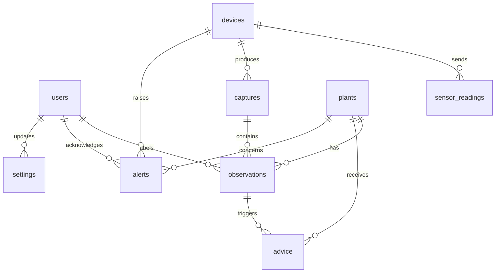

# Database Schema

| Field        | Value                                                       |
| ------------ | ----------------------------------------------------------- |
| Product      | Nutrify                                                     |
| Version      | 0.1 (draft)                                                 |
| Database     | MySQL 8.0 (InnoDB, `utf8mb4`)                               |
| Migrations   | Flask-Migrate (Alembic), files in `backend/migrations/`     |
| Last updated | 2026-11-05                                                  |
| Related      | [Architecture](Architecture.md), [API](API.md), [ML](ML.md) |

## 1. Conventions

| Topic         | Convention                                                                       |
| ------------- | -------------------------------------------------------------------------------- |
| Table names   | Plural `snake_case` (`sensor_readings`)                                          |
| Model classes | Singular `PascalCase` (`SensorReading`)                                          |
| Primary key   | `id BIGINT UNSIGNED AUTO_INCREMENT` (except `settings`)                          |
| Foreign keys  | `<singular_table>_id` (for example `device_id`)                                  |
| Timestamps    | `DATETIME(3)` stored in UTC; `created_at` and `updated_at` where useful          |
| Units         | pH (unitless), `ec` in mS/cm, `tds_ppm` in ppm, `temperature` in degrees Celsius |
| Enumerations  | MySQL `ENUM` with lowercase English codes; the UI maps them to Indonesian labels |
| Text language | English codes and identifiers; no Indonesian text is stored as data              |

## 2. Entity relationships

## 3. Enumerations

| Name             | Values                                                                      |
| ---------------- | --------------------------------------------------------------------------- |
| `plant_class`    | `normal`, `n_deficiency`, `fe_deficiency`                                   |
| `qc_status`      | `ok`, `invalid_leaf`, `stale_sensor`, `needs_check`                         |
| `user_role`      | `admin`, `viewer`                                                           |
| `device_type`    | `sensor_node`, `webcam`                                                     |
| `severity`       | `info`, `warning`, `critical`                                               |
| `advice_source`  | `llm`, `rules`                                                              |
| `advice_trigger` | `plant_status`, `sensor_range`                                              |
| `alert_code`     | `sensor_out_of_range`, `plant_deficiency`, `device_offline`, `sensor_stale` |

## 4. Tables

### 4.1 `users`

| Column        | Type            | Null | Notes                    |
| ------------- | --------------- | ---- | ------------------------ |
| id            | BIGINT UNSIGNED | no   | PK                       |
| name          | VARCHAR(100)    | no   |                          |
| email         | VARCHAR(255)    | no   | Unique                   |
| password_hash | VARCHAR(255)    | no   | Hashed, never plain text |
| role          | ENUM(user_role) | no   | Default `viewer`         |
| is_active     | TINYINT(1)      | no   | Default 1                |
| last_login_at | DATETIME(3)     | yes  |                          |
| created_at    | DATETIME(3)     | no   |                          |
| updated_at    | DATETIME(3)     | no   |                          |

### 4.2 `devices`

| Column           | Type              | Null | Notes                                           |
| ---------------- | ----------------- | ---- | ----------------------------------------------- |
| id               | BIGINT UNSIGNED   | no   | PK                                              |
| code             | VARCHAR(50)       | no   | Unique, for example `sensor-node-1`, `webcam-1` |
| name             | VARCHAR(100)      | no   |                                                 |
| type             | ENUM(device_type) | no   |                                                 |
| api_key_hash     | VARCHAR(255)      | yes  | Hashed key; null for the webcam                 |
| firmware_version | VARCHAR(50)       | yes  |                                                 |
| last_seen_at     | DATETIME(3)       | yes  | Updated on every device call                    |
| is_active        | TINYINT(1)        | no   | Default 1                                       |
| created_at       | DATETIME(3)       | no   |                                                 |

### 4.3 `sensor_readings`

| Column      | Type            | Null | Notes                        |
| ----------- | --------------- | ---- | ---------------------------- |
| id          | BIGINT UNSIGNED | no   | PK                           |
| device_id   | BIGINT UNSIGNED | no   | FK `devices.id`              |
| ph          | DECIMAL(4,2)    | no   | 0.00 to 14.00                |
| ec          | DECIMAL(5,3)    | no   | mS/cm                        |
| tds_ppm     | INT             | no   | Derived: `ec x 500`, rounded |
| temperature | DECIMAL(4,1)    | no   | Degrees Celsius              |
| recorded_at | DATETIME(3)     | no   | Time of measurement (UTC)    |
| received_at | DATETIME(3)     | no   | Time the server received it  |

Indexes: `(recorded_at)`, `(device_id, recorded_at)`.

### 4.4 `plants`

Six fixed rows (positions 1 to 6) holding the current state of each hole.

| Column              | Type              | Null | Notes                                          |
| ------------------- | ----------------- | ---- | ---------------------------------------------- |
| id                  | BIGINT UNSIGNED   | no   | PK                                             |
| position            | TINYINT UNSIGNED  | no   | Unique, 1 to 6 (3 x 2 grid, row by row)        |
| current_class       | ENUM(plant_class) | yes  | Stabilised status; null until the first result |
| current_since       | DATETIME(3)       | yes  | When the current status began                  |
| last_observation_id | BIGINT UNSIGNED   | yes  | FK `observations.id`                           |
| updated_at          | DATETIME(3)       | no   |                                                |

### 4.5 `captures`

Stored snapshots of the full frame (taken periodically or on demand).

| Column      | Type            | Null | Notes                            |
| ----------- | --------------- | ---- | -------------------------------- |
| id          | BIGINT UNSIGNED | no   | PK                               |
| device_id   | BIGINT UNSIGNED | no   | FK `devices.id` (the webcam)     |
| image_path  | VARCHAR(255)    | no   | Relative to `storage/snapshots/` |
| captured_at | DATETIME(3)     | no   | UTC                              |

Index: `(captured_at)`.

### 4.6 `observations`

One row per plant hole per stored analysis. It records the exact feature vector used, so any
result can be reproduced and any row can become a dataset record.

| Column          | Type              | Null | Notes                                              |
| --------------- | ----------------- | ---- | -------------------------------------------------- |
| id              | BIGINT UNSIGNED   | no   | PK                                                 |
| plant_id        | BIGINT UNSIGNED   | no   | FK `plants.id`                                     |
| capture_id      | BIGINT UNSIGNED   | yes  | FK `captures.id`; null when no snapshot was stored |
| observed_at     | DATETIME(3)       | no   | UTC                                                |
| mean_r          | DECIMAL(6,2)      | no   | Mean red of leaf pixels (0 to 255)                 |
| mean_g          | DECIMAL(6,2)      | no   | Mean green                                         |
| mean_b          | DECIMAL(6,2)      | no   | Mean blue                                          |
| leaf_area_ratio | DECIMAL(5,4)      | no   | Leaf pixels divided by region pixels               |
| ph              | DECIMAL(4,2)      | yes  | Sensor value used as a feature                     |
| ec              | DECIMAL(5,3)      | yes  | Sensor value used as a feature (mS/cm)             |
| temperature     | DECIMAL(4,1)      | yes  | Sensor value used as a feature (Celsius)           |
| predicted_class | ENUM(plant_class) | yes  | Raw model output for this frame                    |
| stable_class    | ENUM(plant_class) | yes  | After the stabiliser                               |
| confidence      | DECIMAL(4,3)      | yes  | C4.5 leaf purity, 0 to 1                           |
| rule_path       | JSON              | yes  | Conditions from root to leaf                       |
| qc_status       | ENUM(qc_status)   | no   | Default `ok`                                       |
| model_version   | VARCHAR(50)       | yes  | Version from the model registry                    |
| label_class     | ENUM(plant_class) | yes  | Manual ground-truth label                          |
| labeled_by      | BIGINT UNSIGNED   | yes  | FK `users.id`                                      |
| labeled_at      | DATETIME(3)       | yes  |                                                    |

Indexes: `(plant_id, observed_at)`, `(observed_at)`, `(capture_id)`, `(label_class)`.

### 4.7 `advice`

| Column            | Type                 | Null | Notes                                         |
| ----------------- | -------------------- | ---- | --------------------------------------------- |
| id                | BIGINT UNSIGNED      | no   | PK                                            |
| created_at        | DATETIME(3)          | no   |                                               |
| trigger           | ENUM(advice_trigger) | no   |                                               |
| plant_id          | BIGINT UNSIGNED      | yes  | FK `plants.id`                                |
| observation_id    | BIGINT UNSIGNED      | yes  | FK `observations.id`                          |
| plant_class       | ENUM(plant_class)    | yes  | Class that triggered the advice               |
| severity          | ENUM(severity)       | no   |                                               |
| summary           | TEXT                 | no   |                                               |
| likely_causes     | JSON                 | no   | List of strings                               |
| suggested_actions | JSON                 | no   | List of strings                               |
| source            | ENUM(advice_source)  | no   | `llm` or `rules`                              |
| provider          | VARCHAR(50)          | yes  | For example the LLM provider name             |
| model_name        | VARCHAR(100)         | yes  |                                               |
| context           | JSON                 | no   | Facts that were sent to the advisor           |
| cache_key         | VARCHAR(128)         | yes  | Status plus sensor band, used to reuse advice |

Indexes: `(created_at)`, `(plant_id, created_at)`, `(cache_key)`.

### 4.8 `alerts`

Alerts store a code and parameters. The UI builds the Indonesian message from them.

| Column          | Type             | Null | Notes                                        |
| --------------- | ---------------- | ---- | -------------------------------------------- |
| id              | BIGINT UNSIGNED  | no   | PK                                           |
| code            | ENUM(alert_code) | no   |                                              |
| severity        | ENUM(severity)   | no   |                                              |
| params          | JSON             | yes  | For example `{"metric": "ph", "value": 7.1}` |
| plant_id        | BIGINT UNSIGNED  | yes  | FK `plants.id`                               |
| device_id       | BIGINT UNSIGNED  | yes  | FK `devices.id`                              |
| created_at      | DATETIME(3)      | no   |                                              |
| resolved_at     | DATETIME(3)      | yes  |                                              |
| acknowledged_by | BIGINT UNSIGNED  | yes  | FK `users.id`                                |
| acknowledged_at | DATETIME(3)      | yes  |                                              |
| notified        | TINYINT(1)       | no   | Default 0 (external notification sent)       |

Indexes: `(created_at)`, `(resolved_at)`.

### 4.9 `settings`

Key-value store for values editable in the web app.

| Column     | Type            | Null | Notes         |
| ---------- | --------------- | ---- | ------------- |
| key        | VARCHAR(100)    | no   | PK            |
| value      | JSON            | no   |               |
| updated_by | BIGINT UNSIGNED | yes  | FK `users.id` |
| updated_at | DATETIME(3)     | no   |               |

Default keys:

| Key                                  | Default   | Meaning                                                             |
| ------------------------------------ | --------- | ------------------------------------------------------------------- |
| `ph_min`, `ph_max`                   | 5.5, 6.5  | Ideal pH range                                                      |
| `ec_min`, `ec_max`                   | 1.5, 2.0  | Ideal EC range (mS/cm)                                              |
| `temperature_min`, `temperature_max` | 18, 26    | Placeholder range (Celsius), to be validated                        |
| `analysis_interval_seconds`          | 10        | How often the worker analyses a frame                               |
| `observation_store_interval_seconds` | 60        | How often observations are persisted (also stored on status change) |
| `stabilizer_window`                  | 5         | Number of recent results considered                                 |
| `stabilizer_min_votes`               | 3         | Votes needed to change a status                                     |
| `sensor_stale_seconds`               | 120       | Age after which a reading is considered stale                       |
| `consensus_enabled`                  | false     | Optional runtime check with a comparator model                      |
| `roi_config`                         | 6 regions | Calibrated hole regions (JSON)                                      |

## 5. Referential rules

| Relationship                                                    | On delete |
| --------------------------------------------------------------- | --------- |
| `sensor_readings.device_id` to `devices`                        | RESTRICT  |
| `observations.plant_id` to `plants`                             | RESTRICT  |
| `observations.capture_id` to `captures`                         | SET NULL  |
| `observations.labeled_by` to `users`                            | SET NULL  |
| `advice.plant_id`, `advice.observation_id`                      | SET NULL  |
| `alerts.plant_id`, `alerts.device_id`, `alerts.acknowledged_by` | SET NULL  |

## 6. Volume and retention

- Classification runs every 10 seconds, but observations are stored every 60 seconds (or when a
  status changes): about 8,600 rows per day for 6 holes.
- Sensor readings arrive about every 10 seconds: about 8,600 rows per day.
- Snapshot images are stored on disk under `storage/snapshots/`, referenced by `captures`.
- Optional cleanup: purge unlabeled observations and snapshots older than 90 days. Labeled rows are kept.

## 7. Dataset export

The export joins `observations` with `plants` and keeps only usable, labeled rows:

`label_class IS NOT NULL AND qc_status = 'ok'`

| CSV column | Source                |
| ---------- | --------------------- |
| `Mean_R`   | `observations.mean_r` |
| `Mean_G`   | `observations.mean_g` |
